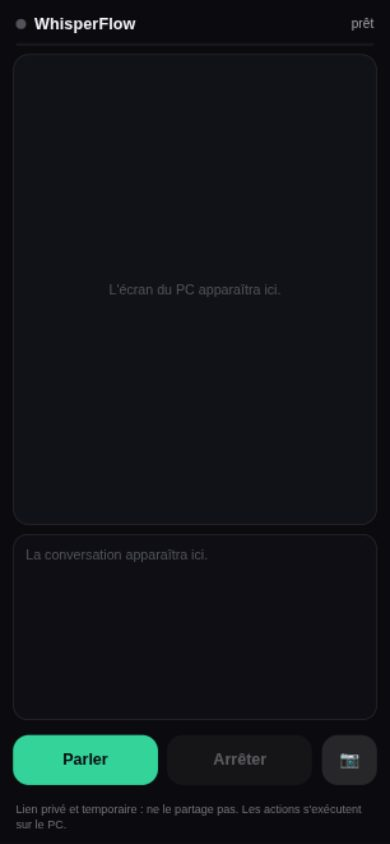

# WhisperFlow 0.3 — dictée, commandes, agents, Gemini Live

Assistant vocal pour Omarchy (Arch + Hyprland, Wayland). Python ≥ 3.11, aucune dépendance Python externe
(l'overlay d'annotation utilise python-gobject du système).

## Installation (Omarchy / Arch Linux)
Prérequis : Arch Linux avec Hyprland/Wayland (testé sur Omarchy), Python ≥ 3.11, un micro.

```bash
git clone https://github.com/emilio-n8n/whisperflow.git
cd whisperflow
./install.sh          # paquets, clés (Groq obligatoire ; OpenCode et Gemini facultatives), service, raccourcis
whisperflow doctor
```

`install.sh` installe les paquets système (sudo), l'application via pipx et un service systemd utilisateur.

## Les trois niveaux
| Touche | Niveau | Ce que ça fait |
|---|---|---|
| SUPER+CTRL+D | 1 Dictée | Tu parles, le texte est tapé là où est le curseur |
| SUPER+CTRL+E | 2 Commande | « ouvre Firefox », « bureau 2 », « monte le son de 20 », « cherche le fichier facture »… |
| SUPER+CTRL+G | 3 Gemini Live | Conversation vocale ; Gemini voit l'écran et agit via les outils de WhisperFlow |
| SUPER+CTRL+X | — | Annule l'enregistrement en cours |
| SUPER+CTRL+Échap | — | Arrêt d'urgence : Gemini, agents, minuteurs |
| SUPER+ALT+R | — | Démarre/arrête le lien iPhone (URL en notification) |

`SUPER+CTRL+D` et `E` reprennent les raccourcis Display et Emojis d'Omarchy (désactivés par `hl.unbind`).

### Niveau 2 : commandes et agents
- Ordre : raccourcis appris → règles locales (instantanées, sans IA) → Jev 1.13 via OpenCode Zen (si clé OpenCode).
- Jev choisit seulement une action du catalogue. Sous 60 % de confiance, rien ne se passe et une notification l'explique.
- Fermer une fenêtre, et tout ce qu'OpenCode veut faire hormis lire ou chercher, passe par une notification Oui/Non. Sans réponse, c'est non.
- Exemple d'agent : « demande à OpenCode dans whisperflow d'ajouter des tests ». La tâche tourne en fond, avec une session persistante par dossier et une notification à la fin.
- Raccourcis appris : `whisperflow learn travail "ouvre chromium" "bureau 2" --phrase "mode boulot"`.

Tester sans micro : `whisperflow route "bureau 2"` (sans exécuter) ou `whisperflow run "bureau 2"`.

La dictée ne presse jamais Entrée : les retours à la ligne sont aplatis en espaces pour ne pas envoyer un message dans un champ de chat. Pour les garder : `newlines = true` dans `[inject]`.

### Niveau 3 : Gemini Live
- Outils exposés à Gemini : `run_command` (catalogue), `look_at_screen`, `find_on_screen`, `show_me` (cadre sans clic), `delegate_code`, `agent_status`.
- Le computer use (`click_text`, `type_text`, `press_keys`, `scroll`) est **désactivé par défaut**. Pour l'activer : `computer_use = true` dans `[live]`.
  - Clic uniquement sur un texte lu par OCR, revérifié sur une capture neuve.
  - Mots sensibles (supprimer, envoyer, payer…) → confirmation.
  - Liste blanche de touches.
  - Nouvelle capture après chaque action.

### Accès iPhone : `whisperflow remote`
- `whisperflow remote` démarre un serveur local et un tunnel Cloudflare (`cloudflared`), puis affiche une URL HTTPS/WSS `trycloudflare.com`.
- Ouvre l'URL sur l'iPhone : bouton **Parler**, micro du téléphone, voix de Gemini en retour, captures de l'écran du PC (~1 image/1,5 s max) et transcription en direct.
- Les outils et les actions restent sur le PC : Gemini peut agir exactement comme en local.
- `whisperflow remote stop` coupe tout ; le lien expire seul (`token_ttl_min`, 120 min par défaut) et `SUPER+CTRL+Échap` l'arrête aussi.
- Sécurité : écoute `127.0.0.1` uniquement, jeton aléatoire obligatoire, un seul client. L'URL est publique : quiconque l'a avec le jeton peut piloter le PC via Gemini — ne la partage pas.

## Accès iPhone en images


## Développement
```bash
python -m pytest -q          # 99 tests hors ligne (aucun micro, aucun réseau)
```

## Commandes utiles
`whisperflow status | last | agents | agent-cancel | shortcuts | forget NOM | show "Enregistrer" | live status | remote [start|stop|status]`
Journal : `journalctl --user -u whisperflow -f`.
